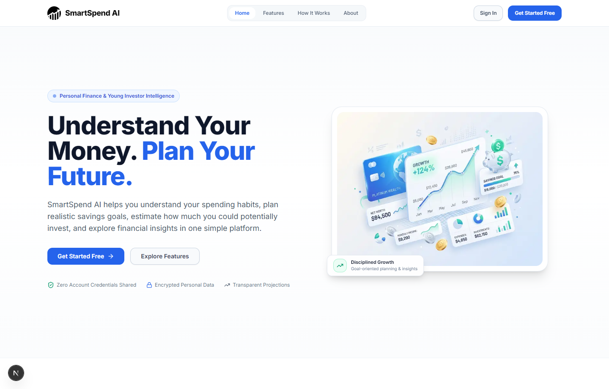
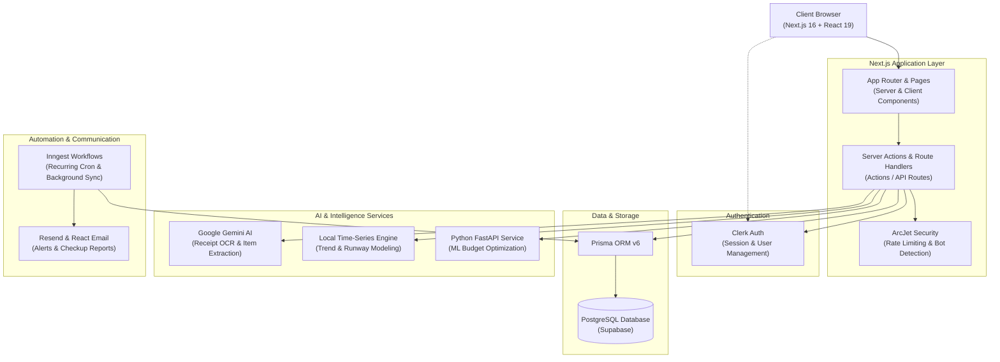

# SmartSpend AI

<div align="center">

**Understand Your Money. Plan Your Future.**

An intelligent personal finance and young investor platform engineered for spending analysis, multi-account ledger tracking, goal-driven savings planning, predictive expenditure forecasting, and automated receipt recognition.

[](https://nextjs.org/)
[](https://react.dev/)
[](https://www.prisma.io/)
[](https://supabase.com/)
[](https://tailwindcss.com/)
[](https://clerk.com/)
[](LICENSE)

[Live Demo](https://smartspend-ai-six.vercel.app/) • [Key Features](#key-features) • [Tech Stack](#tech-stack) • [Architecture](#architecture-overview) • [Getting Started](#getting-started) • [Environment Variables](#environment-variables)

</div>

---

## Home Screen Preview



*The SmartSpend AI home screen featuring personal finance and young investor intelligence, responsive navigation, value highlights, and disciplined financial planning capabilities.*

---

## About the Project

**SmartSpend AI** is a full-stack personal finance application designed to help everyday savers, students, and young professionals build healthy financial habits. Rather than requiring users to surrender private banking credentials, SmartSpend AI provides a secure, privacy-first ledger system augmented with AI and statistical modeling.

With SmartSpend AI, users can:
- **Track & Categorize Spending:** Maintain real-time ledgers across multiple accounts (Savings, Checking, Cash) with automatic balance recalculations.
- **Set & Protect Budgets:** Establish monthly spending thresholds, monitor burn rates, and receive automated email checkups.
- **Plan Financial Milestones:** Allocate savings toward emergency funds, education, gadgets, or travel, and project compounding returns.
- **Forecast Upcoming Expenses:** Run simulations to predict future cashflow runways and gauge the impact of planned purchases before spending.
- **Extract Receipts Instantly:** Scan invoices and physical receipts using Google Gemini AI to auto-populate transaction details with zero manual typing.

---

## Key Features

### 1. Expense & Transaction Tracking
- Dual-entry transaction logging supporting both **Income** and **Expense** flows.
- Multi-account management with support for custom account names, default account toggling, and initial balance configuration.
- Real-time balance integrity checks preventing negative balances and enforcing financial consistency.
- Support for automated recurring transactions (Daily, Weekly, Monthly, Yearly).

### 2. AI Receipt Scanner
- Computer vision optical character recognition powered by **Google Gemini 2.5 Flash**.
- Automatically extracts merchant name, date, categorized breakdown, itemized descriptions, and total amount directly from uploaded receipt images.
- Pre-fills transaction creation forms for immediate one-click review and submission.

### 3. Comprehensive Financial Dashboard
- Visual cashflow overview featuring interactive Recharts category distribution and monthly income-vs-expense comparisons.
- Recent activity feed displaying chronological ledger records with quick transaction detail lookup.
- Real-time budget progress bar showing elapsed monthly spend against active thresholds.

### 4. Smart Budgeting & Optimization
- Configurable monthly expense budgets with automated alert tracking.
- Integration with a dedicated **Python FastAPI machine learning microservice** (`ml-service`) providing personalized budget reallocation recommendations.

### 5. Financial Goals & Savings Planner
- Dedicated goal tracking module with target dates, visual progress indicators, and goal category assignments.
- Safe capital allocation workflow allowing users to transfer savings from dedicated accounts toward specific goals.
- Compounding interest simulation tool with dynamic what-if calculators and expected return projections.

### 6. Future Spend Predictor
- Local statistical time-series forecasting engine based on historical expenditure patterns.
- Interactive scenario testing: enter hypothetical prompts (e.g., *"How will a 5-day trip affect my budget?"*) to simulate runway impact and projected month-end surplus.

### 7. Monthly Reports & Financial Exports
- Period-filtered financial reporting (Day, Week, Month, Year).
- One-click document export generating formatted **PDF statements** (`pdf-lib`), structured **Excel spreadsheets** (`xlsx`), and raw **CSV files** (`json2csv`).

### 8. Automation & Security
- Background task orchestration powered by **Inngest** for scheduled recurring transactions and monthly budget summaries.
- Transactional notification delivery powered by **Resend** and **React Email**.
- API bot protection and rate limiting managed by **ArcJet**.
- Enterprise authentication, multi-factor support, and user profile management powered by **Clerk**.

---

## Technology Stack

| Category | Technologies |
| :--- | :--- |
| **Frontend** | [Next.js 16](https://nextjs.org/) (App Router), [React 19](https://react.dev/), [Tailwind CSS](https://tailwindcss.com/), [Radix UI](https://www.radix-ui.com/), [Framer Motion](https://www.framer.com/motion/), [Lucide React](https://lucide.dev/), [Recharts](https://recharts.org/) |
| **Backend & APIs** | Next.js Server Actions, Next.js Route Handlers (`app/api/`), [ArcJet](https://arcjet.com/) (Rate Limiting & Bot Detection) |
| **Database & ORM** | [PostgreSQL](https://www.postgresql.org/) via [Supabase](https://supabase.com/), [Prisma ORM v6](https://www.prisma.io/) |
| **AI & ML Microservices** | [Google Gemini AI](https://ai.google.dev/) (`@google/generative-ai`), Custom Time-Series Engine (`lib/future-spend-engine.js`), [Python FastAPI](https://fastapi.tiangolo.com/) (`ml-service/`) |
| **Document Processing** | [PDF-Lib](https://pdf-lib.js.org/) (PDF generation), [SheetJS (xlsx)](https://sheetjs.com/) (Excel exports), [json2csv](https://www.npmjs.com/package/json2csv) |
| **Background Jobs & Email** | [Inngest](https://www.inngest.com/) (Task queues & crons), [Resend](https://resend.com/) & [React Email](https://react.email/) |
| **Authentication** | [Clerk Auth](https://clerk.com/) |
| **Deployment** | [Vercel](https://vercel.com/) (Web application), Supabase (Managed Postgres) |

---

## Architecture Overview



---

## Project Structure

```
ai-finance-platform/
├── actions/             # Next.js Server Actions (account, budget, dashboard, goals, transaction)
├── app/                 # Next.js App Router
│   ├── (auth)/          # Authentication pages (sign-in, sign-up via Clerk)
│   ├── (main)/          # Core platform views (dashboard, account, transaction, goals)
│   ├── api/             # API routes (future-spend, inngest, reports, smart-budget)
│   ├── future-spend/    # Predictive forecasting interface
│   ├── goals/           # Financial Goals & Planner view
│   ├── reports/         # Monthly statements & report export generator
│   ├── smart-budget/    # AI smart budget recommendations workspace
│   ├── globals.css      # Design tokens and global CSS
│   ├── layout.js        # Root application layout and font definitions
│   └── page.js          # Public landing home page
├── components/          # Reusable UI primitives and section components
│   ├── ui/              # Radix UI and Tailwind component library
│   ├── dashboard-sidebar.jsx # Responsive navigation sidebar
│   ├── header.jsx       # Global application navigation bar
│   └── hero.jsx         # Landing page hero presentation
├── data/                # Categories, icon maps, and static datasets
├── docs/                # Project documentation assets
│   └── screenshots/     # Verified application screenshots
├── emails/              # React Email notification templates
├── hooks/               # Custom client hooks (use-fetch, etc.)
├── lib/                 # Core utilities (Prisma client, Inngest client, ArcJet, Gemini)
├── ml-service/          # Python FastAPI microservice for ML budget recommendations
├── prisma/              # Prisma schema definition and migrations
├── public/              # Static public assets, logos, and illustrations
└── scripts/             # Data verification and testing scripts
```

---

## Getting Started

### Prerequisites

Ensure you have the following installed on your machine:
- **Node.js**: `v20.0.0` or higher
- **npm**: `v10.0.0` or higher
- **Python**: `3.9` or higher *(required only for running the optional `ml-service`)*
- **PostgreSQL Database**: Accessible PostgreSQL instance (e.g., Supabase, Neon, or local Postgres)

### 1. Clone the Repository

```bash
git clone https://github.com/Sushant-More-1921/smartspend-ai.git
cd smartspend-ai
```

### 2. Install Dependencies

```bash
npm install
```

### 3. Configure Environment Variables

Create a `.env` file in the root directory by following the template below:

```bash
cp .env.example .env
```

*(See [Environment Variables](#environment-variables) below for details).*

### 4. Setup the Database

Generate the Prisma client and push the schema directly to your PostgreSQL database:

```bash
npx prisma generate
npx prisma db push
```

### 5. Start the Development Server

```bash
npm run dev
```

Open [http://localhost:3000](http://localhost:3000) in your browser to view the application.

---

### Optional: Running the Python ML Microservice

The Python FastAPI microservice powers machine learning budget recommendations for the Smart Budget page.

```bash
# Navigate to the service directory
cd ml-service

# Create and activate a virtual environment
# Windows:
python -m venv venv
venv\Scripts\activate

# macOS / Linux:
python3 -m venv venv
source venv/bin/activate

# Install Python dependencies
pip install -r requirements.txt

# Start the FastAPI server
uvicorn main:app --reload --port 8000
```

The ML service will be accessible at `http://localhost:8000`.

---

## Environment Variables

Configure the following environment variables in your `.env` file located in the root directory:

```env
# Database Configuration (PostgreSQL / Supabase)
DATABASE_URL="postgresql://postgres:[PASSWORD]@[HOST]:[PORT]/postgres?sslmode=require"
DIRECT_URL="postgresql://postgres:[PASSWORD]@[HOST]:[PORT]/postgres?sslmode=require"

# Clerk Authentication
NEXT_PUBLIC_CLERK_PUBLISHABLE_KEY="pk_test_..."
CLERK_SECRET_KEY="sk_test_..."
NEXT_PUBLIC_CLERK_SIGN_IN_URL="/sign-in"
NEXT_PUBLIC_CLERK_SIGN_UP_URL="/sign-up"
NEXT_PUBLIC_CLERK_AFTER_SIGN_IN_URL="/dashboard"
NEXT_PUBLIC_CLERK_AFTER_SIGN_UP_URL="/dashboard"

# Google Gemini AI (Receipt OCR)
GEMINI_API_KEY="AIzaSy..."

# Resend Email Service
RESEND_API_KEY="re_..."

# ArcJet Application Security
ARCJET_KEY="ajkey_..."

# Machine Learning Service URL (Defaults to localhost:8000 in dev)
ML_SERVICE_URL="http://localhost:8000"
```

> **Security Note:** Never commit your actual `.env` file or sensitive API keys to version control.

---

## Available Scripts

| Command | Description |
| :--- | :--- |
| `npm run dev` | Launches the Next.js development server with Webpack. |
| `npm run build` | Compiles an optimized production build. |
| `npm run start` | Starts the production server using the compiled build. |
| `npm run lint` | Runs ESLint checks across the codebase. |
| `npm run email` | Launches the React Email local preview server. |

---

## Live Demo

A live production deployment is available at:
**[https://smartspend-ai-six.vercel.app/](https://smartspend-ai-six.vercel.app/)**

---

## Future Improvements

- [ ] **Multi-Currency & FX Conversion:** Automatic exchange rate conversion for multi-national expenditures.
- [ ] **Bank Feed Integrations:** Read-only Account Aggregator / open banking connectivity for automatic transaction synchronization.
- [ ] **Investment Portfolio Tracking:** Real-time stock, mutual fund, and ETF portfolio valuation tracker.
- [ ] **Mobile Client:** Dedicated native companion application built with React Native.

---

## Contributing

Contributions are welcome! If you have suggestions or find bugs, feel free to submit an issue or pull request:

1. Fork the Project.
2. Create your Feature Branch (`git checkout -b feature/AmazingFeature`).
3. Commit your Changes (`git commit -m 'Add some AmazingFeature'`).
4. Push to the Branch (`git push origin feature/AmazingFeature`).
5. Open a Pull Request.

---

## License

This project is licensed under the **MIT License**. See the [LICENSE](LICENSE) file for more information.
